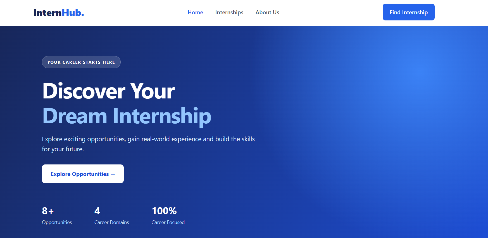
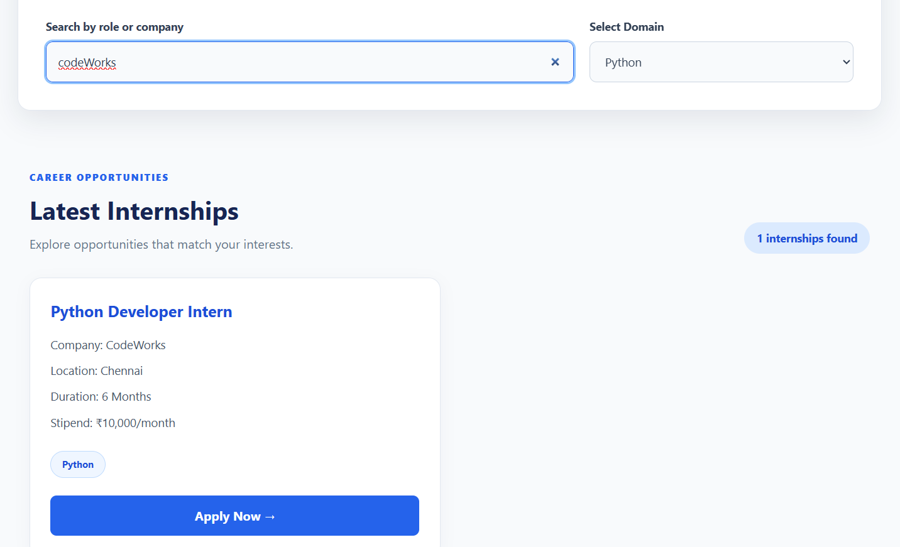
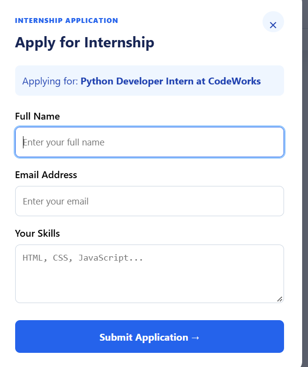

# InternHub – Internship Listing Website

## About the Project
InternHub is a responsive internship listing website that helps students explore internship opportunities. Users can search internships, filter them by domain, and apply through a demo application form.

## Features
- Responsive design for desktop, tablet, and mobile.
- Search internships by title or company.
- Filter internships by domain.
- Display internship details.
- Apply Now button with an application form.
- Form validation.
- Empty results message.
- Accessible HTML elements and interactions.

## Technologies Used
- HTML5
- CSS3
- JavaScript

## Project Screenshots

### 1. Homepage

### 2. Search and Filter

### 3. Application Form

### 4. Mobile View

## How to Run the Project
1. Download or clone this repository.
2. Open the project folder.
3. Open `index.html` in your browser.

## Note
This is a frontend demonstration project. Application details are not stored or sent to companies.

## Author
Akil
